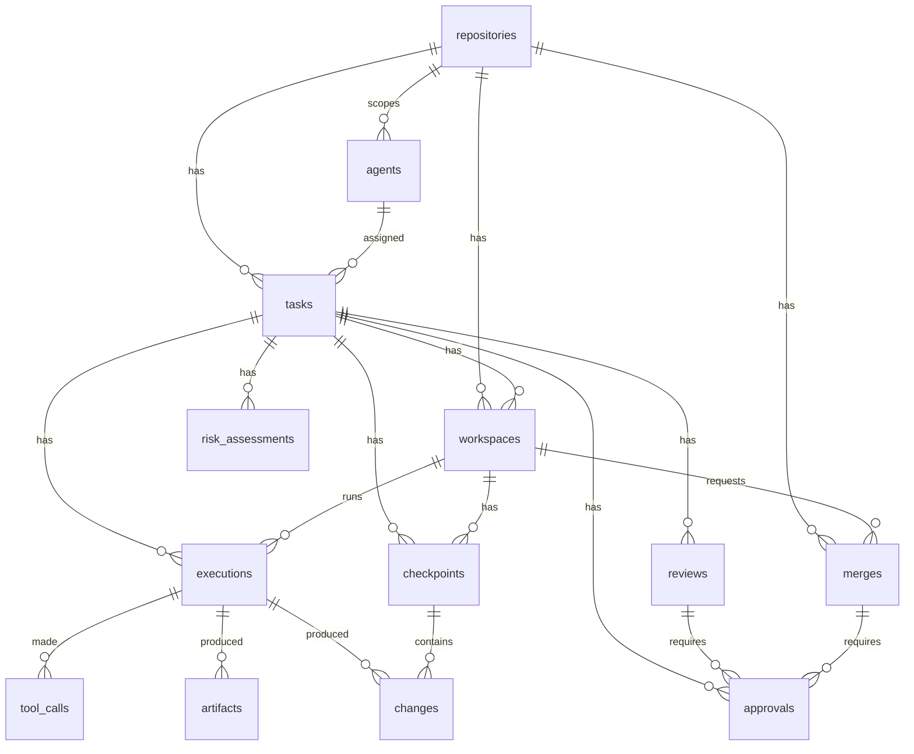

# Database schema

PostgreSQL in production, SQLite for development and tests (same models, same migrations).
Migrations live in `apps/api/src/forgeflow_api/migrations` (Alembic) and run automatically on API start
(`FORGEFLOW_AUTO_MIGRATE=true`) or manually with `alembic -c apps/api/alembic.ini upgrade head`.

All application entities use UUID primary keys. JSON columns are `JSONB` on PostgreSQL. Timestamps are
timezone-aware UTC. Foreign keys and the hot filter columns (`repository_id`, `task_id`, `agent_id`,
`workspace_id`, `execution_id`, `status`, `created_at`) are indexed.

## Relationships

## Audit events

`events` is append-only, enforced twice: the ORM refuses UPDATE/DELETE, and database triggers
(`events_no_update` / `events_no_delete`) reject them for any client. Each row stores
`prev_hash` and `hash = sha256(prev_hash ‖ canonical_json(event))`. `event_chain_head` holds the
latest hash and is row-locked while appending, so concurrent writers form one linear chain.
`GET /api/v1/events/verify` recomputes the chain.

## Tables

### `event_chain_head`

| Column | Type | Null | Notes |
|---|---|---|---|
| `id` | integer | no | PK |
| `hash` | varchar(64) | no |  |
| `count` | bigint | no |  |

### `events`

| Column | Type | Null | Notes |
|---|---|---|---|
| `seq` | bigint | no | PK |
| `id` | uuid | no | unique |
| `type` | varchar(100) | no | indexed |
| `repository_id` | uuid | yes | indexed |
| `task_id` | uuid | yes | indexed |
| `workspace_id` | uuid | yes | indexed |
| `execution_id` | uuid | yes | indexed |
| `agent_id` | uuid | yes | indexed |
| `subject_type` | varchar(64) | yes |  |
| `subject_id` | varchar(64) | yes |  |
| `actor_type` | varchar(16) | no |  |
| `actor_id` | varchar(200) | no |  |
| `message` | text | no |  |
| `payload` | jsonb | no |  |
| `prev_hash` | varchar(64) | no |  |
| `hash` | varchar(64) | no | unique |
| `created_at` | timestamptz | no | indexed |

Index on (subject_type, subject_id)

### `policies`

| Column | Type | Null | Notes |
|---|---|---|---|
| `id` | uuid | no | PK |
| `scope` | varchar(64) | no | indexed |
| `version` | integer | no |  |
| `document` | text | no |  |
| `active` | boolean | no | indexed |
| `created_by` | varchar(200) | yes |  |
| `created_at` | timestamptz | no | indexed |

Unique on (scope, version)

### `repositories`

| Column | Type | Null | Notes |
|---|---|---|---|
| `id` | uuid | no | PK |
| `name` | varchar(200) | no | unique |
| `description` | text | no |  |
| `default_branch` | varchar(200) | no |  |
| `storage_path` | text | no |  |
| `source_url` | text | yes |  |
| `engine` | varchar(32) | no |  |
| `settings` | jsonb | no |  |
| `created_at` | timestamptz | no | indexed |

### `agents`

| Column | Type | Null | Notes |
|---|---|---|---|
| `id` | uuid | no | PK |
| `repository_id` | uuid | yes | FK → repositories.id, indexed |
| `name` | varchar(200) | no | unique |
| `description` | text | no |  |
| `kind` | varchar(32) | no |  |
| `model` | varchar(200) | no |  |
| `model_version` | varchar(200) | yes |  |
| `provider` | varchar(100) | yes |  |
| `capabilities` | jsonb | no |  |
| `token_hash` | varchar(64) | no | unique |
| `status` | varchar(32) | no | indexed |
| `created_at` | timestamptz | no | indexed |

### `tasks`

| Column | Type | Null | Notes |
|---|---|---|---|
| `id` | uuid | no | PK |
| `repository_id` | uuid | no | FK → repositories.id, indexed |
| `agent_id` | uuid | yes | FK → agents.id, indexed |
| `title` | varchar(500) | no |  |
| `description` | text | no |  |
| `status` | varchar(32) | no | indexed |
| `priority` | varchar(16) | no |  |
| `base_commit` | varchar(64) | no |  |
| `labels` | jsonb | no |  |
| `created_by` | varchar(200) | yes |  |
| `created_at` | timestamptz | no | indexed |
| `started_at` | timestamptz | yes |  |
| `completed_at` | timestamptz | yes |  |

### `workspaces`

| Column | Type | Null | Notes |
|---|---|---|---|
| `id` | uuid | no | PK |
| `repository_id` | uuid | no | FK → repositories.id, indexed |
| `task_id` | uuid | no | FK → tasks.id, indexed |
| `agent_id` | uuid | yes | FK → agents.id, indexed |
| `status` | varchar(32) | no | indexed |
| `branch` | varchar(300) | no |  |
| `base_commit` | varchar(64) | no |  |
| `current_commit` | varchar(64) | no |  |
| `path` | text | no |  |
| `permissions` | jsonb | no |  |
| `created_at` | timestamptz | no | indexed |
| `updated_at` | timestamptz | no |  |

### `executions`

| Column | Type | Null | Notes |
|---|---|---|---|
| `id` | uuid | no | PK |
| `repository_id` | uuid | no | FK → repositories.id, indexed |
| `workspace_id` | uuid | no | FK → workspaces.id, indexed |
| `task_id` | uuid | no | FK → tasks.id, indexed |
| `agent_id` | uuid | no | FK → agents.id, indexed |
| `status` | varchar(32) | no | indexed |
| `model` | varchar(200) | no |  |
| `model_version` | varchar(200) | yes |  |
| `base_commit` | varchar(64) | no |  |
| `result_commit` | varchar(64) | yes |  |
| `environment` | jsonb | no |  |
| `summary` | jsonb | no |  |
| `error` | text | yes |  |
| `started_at` | timestamptz | no | indexed |
| `finished_at` | timestamptz | yes |  |

### `merges`

| Column | Type | Null | Notes |
|---|---|---|---|
| `id` | uuid | no | PK |
| `repository_id` | uuid | no | FK → repositories.id, indexed |
| `workspace_id` | uuid | no | FK → workspaces.id, indexed |
| `task_id` | uuid | no | FK → tasks.id, indexed |
| `status` | varchar(32) | no | indexed |
| `target_branch` | varchar(200) | no |  |
| `head_commit` | varchar(64) | no |  |
| `evaluation` | jsonb | no |  |
| `merge_commit` | varchar(64) | yes |  |
| `target_head_before` | varchar(64) | yes |  |
| `revert_commit` | varchar(64) | yes |  |
| `requested_by` | varchar(200) | yes |  |
| `created_at` | timestamptz | no | indexed |
| `evaluated_at` | timestamptz | yes |  |
| `merged_at` | timestamptz | yes |  |

### `reviews`

| Column | Type | Null | Notes |
|---|---|---|---|
| `id` | uuid | no | PK |
| `workspace_id` | uuid | no | FK → workspaces.id, indexed |
| `task_id` | uuid | no | FK → tasks.id, indexed |
| `status` | varchar(32) | no | indexed |
| `base_commit` | varchar(64) | no |  |
| `head_commit` | varchar(64) | no |  |
| `diff_stats` | jsonb | no |  |
| `semantic_diff` | jsonb | no |  |
| `policy` | jsonb | no |  |
| `submitted_by` | varchar(200) | yes |  |
| `created_at` | timestamptz | no | indexed |

### `risk_assessments`

| Column | Type | Null | Notes |
|---|---|---|---|
| `id` | uuid | no | PK |
| `workspace_id` | uuid | no | FK → workspaces.id, indexed |
| `task_id` | uuid | no | FK → tasks.id, indexed |
| `head_commit` | varchar(64) | no |  |
| `score` | integer | no |  |
| `severity` | varchar(16) | no | indexed |
| `reasons` | jsonb | no |  |
| `signals` | jsonb | no |  |
| `created_at` | timestamptz | no | indexed |

### `approvals`

| Column | Type | Null | Notes |
|---|---|---|---|
| `id` | uuid | no | PK |
| `workspace_id` | uuid | no | FK → workspaces.id, indexed |
| `task_id` | uuid | no | FK → tasks.id, indexed |
| `review_id` | uuid | yes | FK → reviews.id, indexed |
| `merge_id` | uuid | yes | FK → merges.id, indexed |
| `action` | varchar(100) | no |  |
| `requirement_key` | varchar(500) | no |  |
| `kind` | varchar(32) | no |  |
| `reason` | text | no |  |
| `status` | varchar(16) | no | indexed |
| `head_commit` | varchar(64) | no |  |
| `details` | jsonb | no |  |
| `decided_by` | varchar(200) | yes |  |
| `comment` | text | yes |  |
| `created_at` | timestamptz | no | indexed |
| `decided_at` | timestamptz | yes |  |

### `artifacts`

| Column | Type | Null | Notes |
|---|---|---|---|
| `id` | uuid | no | PK |
| `execution_id` | uuid | yes | FK → executions.id, indexed |
| `repository_id` | uuid | yes | FK → repositories.id, indexed |
| `name` | varchar(300) | no |  |
| `kind` | varchar(64) | no |  |
| `content_type` | varchar(100) | no |  |
| `size` | bigint | no |  |
| `sha256` | varchar(64) | no | indexed |
| `storage_key` | text | no |  |
| `created_at` | timestamptz | no | indexed |

### `checkpoints`

| Column | Type | Null | Notes |
|---|---|---|---|
| `id` | uuid | no | PK |
| `workspace_id` | uuid | no | FK → workspaces.id, indexed |
| `task_id` | uuid | no | FK → tasks.id, indexed |
| `execution_id` | uuid | yes | FK → executions.id, indexed |
| `commit_sha` | varchar(64) | no | indexed |
| `parent_commit` | varchar(64) | no |  |
| `tree_id` | varchar(64) | no |  |
| `message` | text | no |  |
| `task_state` | jsonb | no |  |
| `filesystem` | jsonb | no |  |
| `created_by` | varchar(200) | yes |  |
| `created_at` | timestamptz | no | indexed |

### `tool_calls`

| Column | Type | Null | Notes |
|---|---|---|---|
| `id` | uuid | no | PK |
| `execution_id` | uuid | no | FK → executions.id, indexed |
| `sequence` | integer | no |  |
| `tool` | varchar(64) | no | indexed |
| `command` | text | yes |  |
| `input` | jsonb | no |  |
| `output` | jsonb | no |  |
| `files_affected` | jsonb | no |  |
| `status` | varchar(16) | no | indexed |
| `exit_code` | integer | yes |  |
| `duration_ms` | integer | no |  |
| `policy` | jsonb | no |  |
| `created_at` | timestamptz | no | indexed |

Unique on (execution_id, sequence)

### `changes`

| Column | Type | Null | Notes |
|---|---|---|---|
| `id` | uuid | no | PK |
| `repository_id` | uuid | no | FK → repositories.id, indexed |
| `task_id` | uuid | no | FK → tasks.id, indexed |
| `workspace_id` | uuid | no | FK → workspaces.id, indexed |
| `execution_id` | uuid | yes | FK → executions.id, indexed |
| `agent_id` | uuid | yes | FK → agents.id, indexed |
| `checkpoint_id` | uuid | yes | FK → checkpoints.id, indexed |
| `commit_sha` | varchar(64) | no | indexed |
| `parent_commit` | varchar(64) | no |  |
| `path` | text | no |  |
| `change_type` | varchar(4) | no |  |
| `additions` | integer | no |  |
| `deletions` | integer | no |  |
| `semantic` | jsonb | no |  |
| `created_at` | timestamptz | no | indexed |
